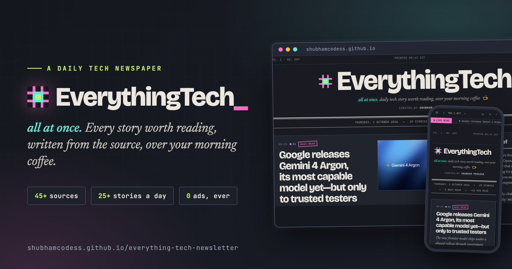
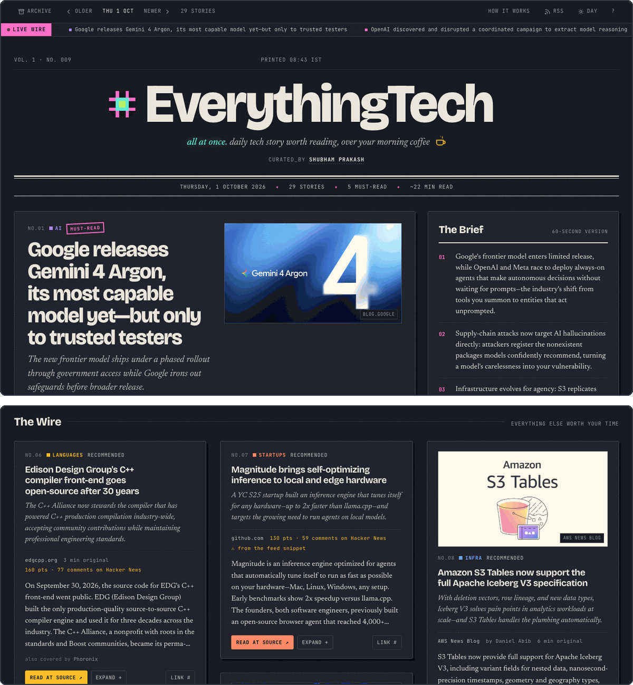
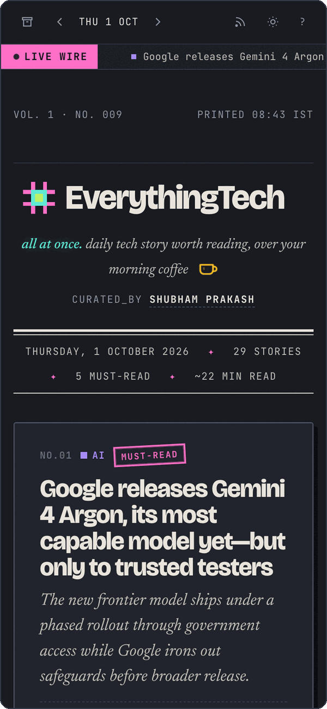
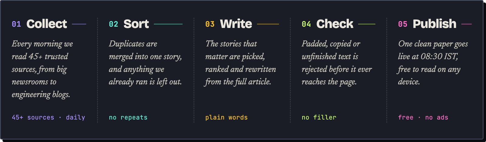

# EverythingTech

*all at once. A daily tech newspaper, over your morning coffee.*

   

**Every tech story worth your time, on one page, every morning.** EverythingTech reads 45+ trusted sources overnight, merges the duplicates, picks the stories that matter and rewrites each one in plain words from the full article. You get a front page to read over coffee, or to skim in 60 seconds.

## Preview

| On your desk | In your pocket |
|:---:|:---:|
|  |  |

The edition of 1 October 2026.

## What you get

- **The 60-second Brief.** The day in five lines, before you read anything else.
- **A real front page.** One lead story, up to six must-reads, then the wire and the quick hits, so you always know what matters most.
- **Written from the source.** Every story is built from the full article, not a headline or a feed blurb, and padded or copied text never makes it onto the page.
- **No repeats.** One story covered by five outlets appears once, crediting all five, and stories that already ran are filtered out so the paper does not repeat itself.
- **Find your topic.** Filter by AI, Dev Tools, Languages, Open Source, Startups, Infra, Security or Engineering, or by how important a story is.
- **Easy on the eyes.** Dark and light themes, keyboard shortcuts for the quick readers, and a layout that works as well on a phone as on a desktop.
- **Never lose a day.** Browse the archive month by month and jump to any past edition.
- **Read it your way.** On the web, in any RSS reader, or as a Markdown file to keep.
- **Take it with you.** One tap on the download arrow turns the day's paper into a clean, print-ready PDF in night or day paper, with every story in full.

## How it works

Every morning the paper is built in five steps: collect, sort, write, check, publish. Nobody has to press a button, and nothing is shown until it has passed the checks.

## Read it

**[shubhamcodess.github.io/everything-tech-newsletter](https://shubhamcodess.github.io/everything-tech-newsletter/)**, with the [RSS feed](https://shubhamcodess.github.io/everything-tech-newsletter/feed.xml) for your reader of choice.

---

**$** curated_by **Shubham Prakash** · [GitHub](https://github.com/shubhamcodess) · [LinkedIn](https://www.linkedin.com/in/shubham-prakash-dev/)

© 2026 Shubham Prakash. All rights reserved. See [LICENSE](LICENSE).
